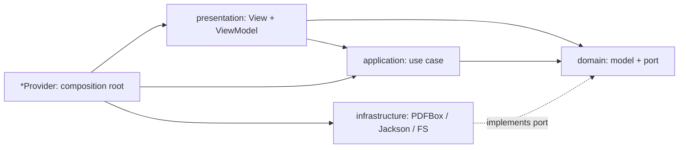
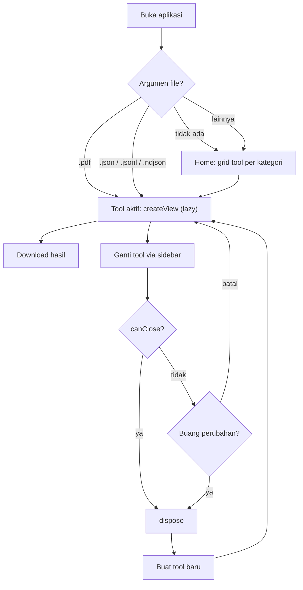

# Toolbox

Superapp desktop berisi kumpulan utility pribadi untuk PDF, JSON, dan developer tools dalam satu aplikasi. Berjalan **100% offline** di **Windows 11** dan **Ubuntu 22.04/24.04**.

> **Status:** dalam pengembangan menuju `v0.1.0`. Lihat [Rencana Rilis](docs/business.md#10-rencana-rilis).
>
> | Bagian | Status |
> |---|---|
> | Tool PDF (Isi & TTD, Gabung, Pisah, Kompres) | ✅ Selesai + test, lihat [Implementasi PDF](#implementasi-pdf) |
> | Shell `app` | ⚠️ Minimal: Home, sidebar, Open with, `Ctrl+H`/`Ctrl+B`. Belum ada: halaman Settings, "Terakhir dipakai", simpan ukuran window, log ke file |
> | Tool JSON (Viewer, Beautify) | ✅ Selesai + test |
> | Tool Dev Utils | ⏳ Belum dimulai |
> | Packaging & release | ⏳ Belum dimulai |

- Satu aplikasi, satu menu: pilih tool dari Home, pindah tool lewat sidebar.
- Dokumen tidak pernah keluar dari komputer: tanpa server, tanpa telemetry.
- Kuat untuk file besar: JSON 400 ribu record (~200 MB) dengan RAM aplikasi < 400 MB.
- Semua hasil bisa di-download dengan satu klik.

## Daftar Isi

- [Daftar Tool](#daftar-tool)
- [Screenshot](#screenshot)
- [Requirement](#requirement)
- [Build, Run, Test](#build-run-test)
- [Implementasi PDF](#implementasi-pdf)
  - [Urutan Pengerjaan File (0–100%)](#urutan-pengerjaan-file-0100)
  - [Testing](#testing)
  - [Compile & Menjalankan](#compile--menjalankan)
- [Packaging](#packaging)
- [Instalasi](#instalasi)
- [Sintaks Query JSON Viewer](#sintaks-query-json-viewer)
- [Data Lokal](#data-lokal)
- [Struktur Module](#struktur-module)
- [Arsitektur](#arsitektur)
- [Menambah Tool Baru](#menambah-tool-baru)
- [Workflow Kontribusi](#workflow-kontribusi)
- [Dokumentasi](#dokumentasi)
- [Lisensi](#lisensi)

## Daftar Tool

| Kategori | Tool | Fungsi | Download |
|---|---|---|---|
| PDF | **Isi & TTD** | Tambah teks, isi form, tempel tanda tangan (gambar manual / upload) | ✅ |
| PDF | **Gabung** | Gabung banyak PDF dengan urutan yang bisa diatur | ✅ |
| PDF | **Pisah** | Pisah per halaman atau per range (`1-3, 5, 8-10`) | ✅ |
| PDF | **Kompres** | Kompres gambar di PDF dengan 3 preset, teks/vektor tidak disentuh | ✅ |
| JSON | **JSON Viewer** | Viewer file besar: tabel/tree, filter query, sort, export JSON/JSONL/CSV | ✅ |
| JSON | **JSON Beautify** | Format, minify, validate. Input paste atau upload `.json` | ✅ |
| Dev Utils | **Hash Generator** | MD5, SHA-1, SHA-2, SHA3 untuk teks, plus mode HMAC | – |
| Dev Utils | **Checksum** | Generate & verify checksum file, format `sha256sum` | ✅ |
| Dev Utils | **Regex Tester** | Uji regex Java: highlight, group, replace, aman dari backtracking | – |
| Dev Utils | **Text Diff** | Side-by-side & unified, highlight per kata, export `.diff` | ✅ |
| Dev Utils | **Base64** | Encode/decode teks & file, URL-safe, MIME, data URI | ✅ |

Kebutuhan dan aturan lengkap tiap tool ada di [docs/business.md](docs/business.md).

## Screenshot

Belum ada screenshot. Untuk menambahkannya:

1. Simpan gambar PNG di `docs/screenshots/`, misalnya `home.png`, `pdf-sign.png`, `json-viewer.png`.
2. Tambahkan di section ini dengan format ``.
3. Gunakan ukuran window default (1200×800) dan tema terang agar konsisten.

## Requirement

| Software | Versi | Keterangan |
|---|---|---|
| [BellSoft Liberica JDK](https://bell-sw.com/pages/downloads/) **Full** | 21 (LTS) | Varian **Full** sudah membawa JavaFX. JDK lain (tanpa JavaFX) tidak bisa dipakai |
| Maven | ≥ 3.9 | Cukup lewat Maven Wrapper (`./mvnw`) |
| Git | terbaru | |
| IntelliJ IDEA | terbaru | Disarankan untuk development |

Instal Liberica JDK 21 Full lewat [SDKMAN](https://sdkman.io/) (Linux):

```bash
sdk list java | grep librca     # cari versi 21.x.x.fx-librca
sdk install java 21.x.x.fx-librca
java -version                   # harus menampilkan "Liberica" dan versi 21
```

Di Windows, gunakan installer resmi (`.msi`) varian **Full JDK**.

User akhir **tidak perlu** menginstal Java. Paket rilis sudah membawa runtime sendiri.

## Build, Run, Test

```bash
# Build + test + cek format + test arsitektur
./mvnw verify

# Rapikan format kode (palantir-java-format)
./mvnw spotless:apply

# Test satu module saja (beserta module yang dibutuhkan)
./mvnw -pl tool-pdf -am test
```

Menjalankan aplikasi setelah build (sama di Linux dan Windows):

```bash
./mvnw package -DskipTests
java -Xmx320m -jar app/target/toolbox-app.jar

# Simulasi "Open with" dengan argumen file
java -Xmx320m -jar app/target/toolbox-app.jar ~/Downloads/contoh.pdf
```

`toolbox-app.jar` memuat `Class-Path` ke `app/target/libs/`, jadi folder `libs/` harus tetap berada di sebelah jar.

Di IntelliJ IDEA: buka `pom.xml` di root sebagai project, set Project SDK ke Liberica 21 Full, lalu jalankan `io.github.lukmnh.toolbox.app.Main` di module `app`.

Detail compile, test, dan troubleshooting ada di [Implementasi PDF](#implementasi-pdf).

## Implementasi PDF

Bagian ini memandu pengerjaan module `tool-pdf` dari nol sampai selesai: file mana yang ditulis lebih dulu, cara mengetesnya, dan cara compile/menjalankan.

Singkatan path yang dipakai di bawah:

| Singkatan | Path lengkap |
|---|---|
| `common/…/` | `common/src/main/java/io/github/lukmnh/toolbox/common/` |
| `common/res/` | `common/src/main/resources/` |
| `pdf/…/` | `tool-pdf/src/main/java/io/github/lukmnh/toolbox/pdf/` |
| `pdf/test/` | `tool-pdf/src/test/java/io/github/lukmnh/toolbox/pdf/` |
| `app/…/` | `app/src/main/java/io/github/lukmnh/toolbox/app/` |

### Urutan Pengerjaan File (0–100%)

Urutan mengikuti arah dependency: **fondasi → domain → application → infrastructure → presentation → perakitan**. Setiap tahap diakhiri titik cek yang harus hijau sebelum lanjut ke tahap berikutnya.

| Tahap | Progres | Isi | Titik cek |
|---|---|---|---|
| 1 | 0 → 5% | POM build | `./mvnw validate` |
| 2 | 5 → 10% | `common`: kategori tool + task API | `./mvnw -pl common compile` |
| 3 | 10 → 20% | `common`: io, settings, i18n, UI, download, CSS, kontrak Tool | `./mvnw -pl common test` |
| 4 | 20 → 32% | PDF `shared` (domain, application, infrastructure) | `PageRangeTest`, `CoordinateMapperTest`, `PdfLoaderTest` |
| 5 | 32 → 40% | Gabung: domain → application → infrastructure | `MergePdfUseCaseTest`, `PdfBoxMergerTest` |
| 6 | 40 → 48% | Pisah: domain → application → infrastructure | `SplitPdfUseCaseTest`, `PdfBoxSplitterTest` |
| 7 | 48 → 60% | Kompres: domain → application → infrastructure | `CompressPdfUseCaseTest`, `PdfBoxCompressorTest` |
| 8 | 60 → 76% | Isi & TTD: domain → application → infrastructure | `SignatureRasterizerTest`, `SignatureImageCleanerTest`, `SignatureUseCasesTest`, `PdfBoxEditorTest` |
| 9 | 76 → 84% | Presentation bersama + UI Gabung, Pisah, Kompres | `./mvnw -pl tool-pdf -am compile` |
| 10 | 84 → 93% | UI Isi & TTD | `./mvnw -pl tool-pdf -am compile` |
| 11 | 93 → 96% | Composition root + registrasi ServiceLoader + `ArchitectureTest` | `./mvnw -pl tool-pdf -am test` |
| 12 | 96 → 100% | Shell `app` minimal + test | `./mvnw verify`, lalu jalankan aplikasi |

**Tahap 1: build (0 → 5%)**

1. `pom.xml`: parent, versi library/plugin, Spotless, Enforcer, `-Xlint:all`
2. `common/pom.xml`
3. `tool-pdf/pom.xml`: dependency `common` + PDFBox
4. `app/pom.xml`: manifest `Main-Class`, salin dependency ke `target/libs`

**Tahap 2: `common` dasar (5 → 10%)**

5. `common/…/tool/ToolCategory.java`
6. `common/…/task/ProgressReporter.java`
7. `common/…/task/TaskCancelledException.java`
8. `common/…/task/CancellationToken.java`
9. `common/…/task/BackgroundWork.java`
10. `common/…/task/RunningTask.java`
11. `common/…/task/TaskRunner.java`: `javafx.concurrent.Task` + virtual thread

**Tahap 3: `common` lengkap (10 → 20%)**

12. `common/…/io/FileExtensions.java`
13. `common/…/io/AtomicFiles.java`
14. `common/…/io/TempFiles.java`
15. `common/…/io/AppDirectories.java`
16. `common/…/settings/Theme.java`
17. `common/…/settings/Settings.java`
18. `common/…/i18n/Messages.java`
19. `common/res/i18n/messages.properties`: semua teks UI
20. `common/…/ui/NotificationAction.java`
21. `common/…/ui/Notifier.java`
22. `common/…/ui/ToastNotifier.java`
23. `common/…/ui/ErrorDialogs.java`
24. `common/…/ui/PasswordDialog.java`
25. `common/…/ui/FileDropZone.java`
26. `common/…/ui/TaskStatusBar.java`
27. `common/…/ui/ByteSizeFormat.java`
28. `common/…/download/UniqueFileNamer.java`
29. `common/…/download/DownloadLocationResolver.java`
30. `common/…/download/DownloadService.java`
31. `common/…/tool/Tool.java`
32. `common/…/tool/ToolProvider.java`
33. `common/…/tool/ToolContext.java`
34. `common/res/css/theme-light.css`, `common/res/css/theme-dark.css`
35. Test: `UniqueFileNamerTest`, `DownloadLocationResolverTest`, `AtomicFilesTest`, `FileExtensionsTest`, `common/…/ArchitectureTest`

**Tahap 4: PDF `shared` (20 → 32%)**

36. `pdf/…/shared/domain/PdfSource.java`
37. `pdf/…/shared/domain/PdfDocumentInfo.java`
38. `pdf/…/shared/domain/PdfToolException.java` beserta 6 subclass-nya: `PasswordRequiredException`, `CorruptPdfException`, `PdfIoException`, `InvalidPageRangeException`, `FormFieldException`, `UnsupportedTextException`. Karena `sealed`, ketujuh file harus ditulis bersamaan sebelum compile.
39. `pdf/…/shared/domain/PageRange.java`
40. `pdf/…/shared/domain/FontSpec.java`
41. `pdf/…/shared/domain/PreviewScale.java`
42. `pdf/…/shared/domain/PdfInspector.java` (port)
43. `pdf/…/shared/application/InspectPdfUseCase.java`
44. `pdf/…/shared/infrastructure/PdfLoader.java`: load dari bytes, mapping error password/corrupt
45. `pdf/…/shared/infrastructure/PdfBoxInspector.java`
46. `pdf/…/shared/infrastructure/FontResolver.java`
47. `pdf/…/shared/infrastructure/PageBox.java`
48. `pdf/…/shared/infrastructure/CoordinateMapper.java`: preview ↔ PDF, 4 rotasi + offset CropBox
49. Test: `pdf/test/testsupport/TestPdfs.java` (pembuat PDF contoh), `PageRangeTest`, `CoordinateMapperTest`, `PdfLoaderTest`

**Tahap 5: Gabung (32 → 40%)**

50. `pdf/…/merge/domain/MergeRequest.java`, `MergeResult.java`
51. `pdf/…/merge/domain/MergeSession.java`, `PdfMerger.java` (port)
52. `pdf/…/merge/application/MergePdfUseCase.java`
53. `pdf/…/merge/infrastructure/PdfBoxMerger.java`
54. Test: `MergePdfUseCaseTest` (fake port), `PdfBoxMergerTest` (PDF asli)

**Tahap 6: Pisah (40 → 48%)**

55. `pdf/…/split/domain/SplitMode.java` (sealed), `SplitRequest.java`, `SplitResult.java`
56. `pdf/…/split/domain/SplitSession.java`, `PdfSplitter.java` (port)
57. `pdf/…/split/application/SplitPdfUseCase.java`
58. `pdf/…/split/infrastructure/PdfBoxSplitter.java`
59. Test: `SplitPdfUseCaseTest`, `PdfBoxSplitterTest`

**Tahap 7: Kompres (48 → 60%)**

60. `pdf/…/compress/domain/CompressionPreset.java`, `CompressRequest.java`, `CompressResult.java`
61. `pdf/…/compress/domain/CompressionSession.java`, `PdfCompressor.java` (port)
62. `pdf/…/compress/application/CompressPdfUseCase.java`
63. `pdf/…/compress/infrastructure/ImageUsageCollector.java`: hitung DPI efektif dari CTM
64. `pdf/…/compress/infrastructure/ImageRecompressor.java`: aturan downscale/JPEG
65. `pdf/…/compress/infrastructure/PdfBoxCompressor.java`
66. Test: `CompressPdfUseCaseTest`, `PdfBoxCompressorTest`

**Tahap 8: Isi & TTD, inti (60 → 76%)**

67. `pdf/…/sign/domain/EditDefaults.java`, `PageGeometry.java`
68. `pdf/…/sign/domain/Overlay.java` (sealed: Text, Image)
69. `pdf/…/sign/domain/FormField.java`, `FieldValue.java` (sealed)
70. `pdf/…/sign/domain/EditSession.java`, `PdfEditor.java` (port)
71. `pdf/…/sign/domain/StrokePoint.java`, `InkColor.java`, `SignatureStroke.java`
72. `pdf/…/sign/domain/SignatureRasterizer.java`: goresan → PNG transparan 3×
73. `pdf/…/sign/domain/SignatureImageCleaner.java`: hapus background putih
74. `pdf/…/sign/domain/SignatureRepository.java` (port)
75. `pdf/…/sign/application/`: `OpenDocumentUseCase`, `RenderPageUseCase`, `UpdateFormFieldUseCase`, `ExportEditedPdfUseCase`, `SaveDrawnSignatureUseCase`, `ImportSignatureImageUseCase`, `LoadLastSignatureUseCase`
76. `pdf/…/sign/infrastructure/AcroFormAdapter.java`
77. `pdf/…/sign/infrastructure/OverlayBurner.java`: burn teks/TTD dengan matrix rotasi
78. `pdf/…/sign/infrastructure/PdfBoxEditor.java`
79. `pdf/…/sign/infrastructure/FileSignatureRepository.java`
80. Test: `SignatureRasterizerTest`, `SignatureImageCleanerTest`, `SignatureUseCasesTest`, `PdfBoxEditorTest`

**Tahap 9: presentation bersama + 3 tool (76 → 84%)**

81. `pdf/…/shared/presentation/PdfErrorMessages.java`, `PdfFailureHandler.java`, `PdfFileChooser.java`, `ToolLayout.java`
82. `pdf/…/merge/presentation/MergeViewModel.java` → `MergeView.java` → `MergeTool.java`
83. `pdf/…/split/presentation/SplitChoice.java` → `SplitViewModel.java` → `SplitView.java` → `SplitTool.java`
84. `pdf/…/compress/presentation/CompressViewModel.java` → `CompressView.java` → `CompressTool.java`

**Tahap 10: UI Isi & TTD (84 → 93%)**

85. `pdf/…/sign/presentation/EditMode.java`, `OverlayItem.java`
86. `pdf/…/sign/presentation/TextOverlayNode.java`, `SignatureOverlayNode.java`
87. `pdf/…/sign/presentation/SignUseCases.java`, `SignViewModel.java`
88. `pdf/…/sign/presentation/PageCanvas.java`: klik, drag, ketik, Ctrl+scroll
89. `pdf/…/sign/presentation/SignatureDialog.java`, `FormFieldPanel.java`
90. `pdf/…/sign/presentation/SignView.java` → `SignTool.java`

**Tahap 11: perakitan module PDF (93 → 96%)**

91. `pdf/…/PdfToolsProvider.java`: composition root, merakit semua dependency secara manual
92. `tool-pdf/src/main/resources/META-INF/services/io.github.lukmnh.toolbox.common.tool.ToolProvider` (isi: `io.github.lukmnh.toolbox.pdf.PdfToolsProvider`)
93. Test: `pdf/test/ArchitectureTest.java`

**Tahap 12: shell `app` (96 → 100%)**

94. `app/…/shell/ToolRegistry.java` (ServiceLoader), `ToolNavigator.java` (`canClose` → `dispose` → lazy `createView`)
95. `app/…/shell/HomeView.java`, `Sidebar.java`, `MainShell.java`
96. `app/…/routing/OpenWithRouter.java`
97. `app/…/ToolboxApplication.java`, `app/…/Main.java`
98. Test: `app/…/ArchitectureTest`, `OpenWithRouterTest`
99. `./mvnw spotless:apply verify`
100. Jalankan aplikasi dan lakukan [tes manual](#tes-manual-pdf)

### Testing

Ada tiga jenis test:

| Jenis | Fungsi | Contoh |
|---|---|---|
| Unit test dengan **fake** | Menguji use case tanpa PDFBox. Port diganti implementasi in-memory sederhana, tanpa library mocking | `MergePdfUseCaseTest`, `SplitPdfUseCaseTest`, `CompressPdfUseCaseTest`, `SignatureUseCasesTest` |
| Integration test dengan **PDF asli** | PDF contoh dibuat on-the-fly oleh `TestPdfs`, diproses PDFBox, lalu hasilnya diperiksa (jumlah halaman, teks, pixel hasil render) | `PdfBoxMergerTest`, `PdfBoxSplitterTest`, `PdfBoxCompressorTest`, `PdfBoxEditorTest` |
| **Architecture test** (ArchUnit) | Menegakkan dependency rule Clean Architecture | `ArchitectureTest` di `common`, `tool-pdf`, `app` |

#### Core functionality yang dites

| Test | Yang dibuktikan |
|---|---|
| `PageRangeTest` | Parsing `1-3, 5, 8-10`, toleran spasi, dan 12 kasus input salah (kosong, format, nol, terbalik, melebihi halaman) dengan alasan yang tepat |
| `CoordinateMapperTest` | Pojok halaman terpetakan benar untuk rotasi 0/90/180/270 dengan offset CropBox, round-trip tampilan ↔ PDF, dan skala preview 144/72 |
| `PdfLoaderTest` | PDF berpassword minta password, password salah terdeteksi, hasil simpan tanpa password, file rusak/hilang, file asli tidak ter-lock |
| `MergePdfUseCaseTest` | Urutan file dipertahankan, progress sampai 100%, cancel tidak menyimpan dan tetap menutup session, minimal 2 file |
| `PdfBoxMergerTest` | Jumlah dan urutan halaman hasil gabung, sumber berpassword |
| `SplitPdfUseCaseTest` | Mode tiap halaman, mode range, nama `<nama>_hal1-3.pdf`, range duplikat tidak saling menimpa, validasi range |
| `PdfBoxSplitterTest` | Isi halaman tiap file hasil benar, PDF berpassword |
| `CompressPdfUseCaseTest` | Hasil lebih kecil dipakai, hasil lebih besar diganti salinan asli ("sudah optimal"), semua halaman dianalisis |
| `PdfBoxCompressorTest` | Gambar ~864 DPI di-downscale ke ±150 DPI dan menjadi JPEG, gambar dengan alpha tidak disentuh, PDF teks saja tetap utuh |
| `PdfBoxEditorTest` | **TTD dan teks tampil persis di posisi preview** (dicek per pixel setelah render ulang) untuk 4 rotasi × 2 CropBox, baseline teks tepat di titik klik, leading 1.2×, isi form tersimpan, error form tidak crash, export tidak mengubah dokumen yang sedang diedit |
| `SignatureRasterizerTest` | Crop ke bounding box + padding pada skala 3×, background transparan, warna tinta sesuai, klik tunggal menjadi titik |
| `SignatureImageCleanerTest` | Kertas putih menjadi transparan, warna tinta biru dipertahankan, PNG beralpha tidak diubah, gambar > 1500 px di-downscale |
| `ArchitectureTest` (pdf) | `domain` hanya memakai JDK; `application` hanya domain + `common.task`; `infrastructure` tidak mengenal UI; `presentation` tidak memanggil PDFBox/`Files`; folder tool tidak saling import |

#### Perintah test

```bash
# Semua test di semua module
./mvnw test

# Hanya module PDF (beserta common)
./mvnw -pl tool-pdf -am test

# Satu class test
./mvnw -pl tool-pdf -am test -Dtest=CoordinateMapperTest -Dsurefire.failIfNoSpecifiedTests=false

# Satu method test (boleh pakai wildcard)
./mvnw -pl tool-pdf -am test -Dtest='PdfBoxEditorTest#signature*' -Dsurefire.failIfNoSpecifiedTests=false
```

Laporan test ada di `*/target/surefire-reports/`. Saat ini ada 124 test (common 22, tool-pdf 96, app 6).

#### Tes manual PDF

Jalankan aplikasi (lihat [Compile & Menjalankan](#compile--menjalankan)), lalu cek:

- [ ] **Isi & TTD**: buka PDF lewat tombol, drag-drop, atau `java -jar app/target/toolbox-app.jar file.pdf`.
- [ ] Mode **Tambah Teks**: klik halaman lalu ketik langsung. Enter membuat baris baru, Esc selesai. Double-click untuk edit lagi, drag untuk geser, Delete untuk hapus. Spinner ukuran font berlaku ke teks terpilih.
- [ ] **Gambar TTD…** (hitam/biru, tebal pena) dan **Upload TTD…** (JPG foto tanda tangan di kertas putih: background harus hilang).
- [ ] Mode **Tempel TTD**: klik untuk menempel, drag untuk geser, `Ctrl+scroll` di atas TTD terpilih untuk resize. Tanpa seleksi, `Ctrl+scroll` = zoom.
- [ ] PDF dengan form: isi field di panel kanan, halaman ter-render ulang.
- [ ] PDF yang halamannya di-rotate: posisi teks/TTD di hasil download sama dengan di preview.
- [ ] Tutup aplikasi atau pindah tool sebelum download: muncul dialog "Buang perubahan?".
- [ ] Tutup lalu buka lagi aplikasi: TTD terakhir otomatis termuat (`~/.toolbox/signature.png`).
- [ ] **Gabung**: drag-drop beberapa PDF, urutkan dengan drag/Naik/Turun, Gabungkan, lalu Download → `merged.pdf`. Download kedua kali → `merged (1).pdf`.
- [ ] **Pisah**: range `1-2, 4` → folder `<nama>_split/` berisi `<nama>_hal1-2.pdf` dan `<nama>_hal4.pdf`. Range `9-12` pada PDF 5 halaman → pesan error yang jelas.
- [ ] **Kompres**: PDF hasil scan → ukuran turun dan persentase hemat tampil. PDF teks saja → "sudah optimal".
- [ ] PDF berpassword di semua tool: dialog password muncul. Password salah → peringatan, lalu coba lagi.
- [ ] Drop file non-PDF → toast "Hanya file PDF yang diterima".
- [ ] Toast setelah download: tombol **Buka file** dan **Buka folder** berfungsi.

### Compile & Menjalankan

**1. Pastikan JDK yang benar.** JavaFX harus berasal dari JDK (Liberica Full).

```bash
java -version                          # harus "BellSoft" / Liberica, versi 21
java --list-modules | grep javafx      # harus ada javafx.controls dan javafx.swing
```

Kalau ada beberapa JDK (Linux), pilih Liberica untuk sesi ini:

```bash
export JAVA_HOME=/usr/lib/jvm/bellsoft-java21-full-amd64   # sesuaikan path-nya
export PATH="$JAVA_HOME/bin:$PATH"
```

**2. Compile, test, dan package.**

| Perintah | Fungsi |
|---|---|
| `./mvnw compile` | Compile semua module (cepat, tanpa test) |
| `./mvnw spotless:apply` | Rapikan format kode. Jalankan sebelum `verify` |
| `./mvnw test` | Compile + unit test + architecture test |
| `./mvnw verify` | Seperti `test`, ditambah `spotless:check`. Perintah ini yang dijalankan CI |
| `./mvnw package -DskipTests` | Buat `app/target/toolbox-app.jar` + `app/target/libs/` |
| `./mvnw clean` | Hapus semua folder `target/` |

Di Windows, ganti `./mvnw` dengan `.\mvnw.cmd`.

**3. Jalankan.**

```bash
java -Xmx320m -jar app/target/toolbox-app.jar                     # buka Home
java -Xmx320m -jar app/target/toolbox-app.jar ~/Downloads/a.pdf   # langsung ke Isi & TTD
```

Saat pertama kali merender PDF, PDFBox membangun cache font sistem (beberapa detik, log `Building on-disk font cache`). Ini hanya terjadi sekali.

**Troubleshooting**

| Gejala | Penyebab | Solusi |
|---|---|---|
| `package javafx.scene does not exist` | JDK yang dipakai bukan Liberica **Full** | Install Liberica 21 Full, set `JAVA_HOME` |
| Enforcer: `RequireJavaVersion failed` | Java < 21 | Ganti ke JDK 21 |
| `The following files had format violations` | Format kode tidak sesuai palantir-java-format | `./mvnw spotless:apply` |
| `ArchitectureTest` gagal | Ada import yang melanggar dependency rule (misalnya presentation memanggil PDFBox) | Pindahkan logika ke layer yang benar, baca pesan ArchUnit |
| `Unable to open DISPLAY` saat menjalankan aplikasi | Tidak ada display (SSH/CI) | Jalankan di desktop, atau `xvfb-run java -jar …` |
| `java -jar` error `NoClassDefFoundError` | Folder `app/target/libs/` hilang atau jar dipindah sendirian | Jalankan ulang `./mvnw package -DskipTests`, pindahkan jar bersama `libs/` |

## Packaging

Packaging memakai `jpackage` lewat script, sehingga hasil lokal sama dengan CI:

```bash
# Ubuntu → .deb + portable .tar.gz
./packaging/package-linux.sh
```

```powershell
# Windows → portable .zip (tanpa WiX)
.\packaging\package-windows.ps1
```

Icon aplikasi bersifat opsional. Letakkan di `packaging/icons/` dan script akan memakainya kalau ada.

Rilis resmi dibuat otomatis oleh GitHub Actions setiap ada tag `vX.Y.Z`. Lihat [Workflow Kontribusi](#workflow-kontribusi).

## Instalasi

Unduh paket dari halaman **Releases** di GitHub.

### Ubuntu: `.deb`

```bash
sudo apt install ./toolbox_*.deb     # install
sudo apt remove toolbox              # uninstall
```

Toolbox muncul di menu aplikasi (grup **Utility**) dan bisa dipakai lewat "Open with" untuk file `.pdf` dan `.json`.

### Ubuntu: portable `.tar.gz` (tanpa sudo)

```bash
tar -xzf toolbox-*-linux.tar.gz -C ~/Applications
~/Applications/Toolbox/bin/Toolbox
```

Uninstall: hapus folder `~/Applications/Toolbox`.

### Windows: portable `.zip`

1. Extract zip ke folder mana saja, misalnya `C:\Apps\Toolbox`.
2. Jalankan `Toolbox.exe`.
3. Opsional: klik kanan file `.pdf` / `.json` → **Open with** → **Choose another app** → pilih `Toolbox.exe`.

Uninstall: hapus folder hasil extract.

> Pengaturan dan log tersimpan di `~/.toolbox/` dan tidak ikut terhapus saat uninstall. Hapus manual kalau perlu.

## Sintaks Query JSON Viewer

Format dasar: `field operator value`, digabung dengan `AND`, `OR`, dan kurung `( )`.

| Operator | Arti | Contoh |
|---|---|---|
| `=` / `!=` | Sama / tidak sama | `status = "active"` |
| `>` `<` `>=` `<=` | Perbandingan angka/teks | `age >= 30` |
| `contains` | Mengandung teks | `name contains "budi"` |
| `startsWith` | Diawali teks | `sku startsWith "PRD-"` |
| `exists` | Field ada | `email exists` |
| `isNull` | Field bernilai `null` | `deletedAt isNull` |

| Elemen | Aturan |
|---|---|
| Path | Nested `a.b.c`, index array `items[0].id` |
| String | Wajib pakai tanda kutip: `"Jakarta"` |
| Angka | Tanpa kutip: `100`, `-2.5` |
| Literal | `true`, `false`, `null` |

Contoh:

```text
status = "active" AND age >= 30
(role = "admin" OR role = "owner") AND address.city = "Bandung"
items[0].price > 100000 AND customer.email exists
```

Kalau query salah, pesan error menunjukkan posisi karakter yang bermasalah.

## Data Lokal

Toolbox tidak memakai database. Semua data tersimpan di folder home:

| Path | Isi |
|---|---|
| `~/.toolbox/settings.json` | Folder download, tema, ukuran window, state sidebar |
| `~/.toolbox/recent.json` | Tool dan file JSON terakhir dipakai |
| `~/.toolbox/signature.png` | Tanda tangan terakhir |
| `~/.toolbox/logs/` | Log aplikasi (maks 5 file × 1 MB) |

Folder download default: `%USERPROFILE%\Downloads` (Windows), atau `XDG_DOWNLOAD_DIR` dengan fallback `~/Downloads` (Linux). Bisa diganti di **Settings**.

## Struktur Module

```text
toolbox/
├── pom.xml              # parent: versi, dependencyManagement, pluginManagement
├── common/              # kontrak Tool, download, task runner, settings, UI reusable, i18n, tema CSS
├── tool-pdf/            # Isi & TTD, Gabung, Pisah, Kompres
├── tool-json/           # JSON Viewer, JSON Beautify
├── tool-devutils/       # Hash, Checksum, Regex, Text Diff, Base64
├── app/                 # shell: Home, sidebar, routing, Settings, main class
├── tools/               # GenerateSample.java (generator JSON dummy)
├── packaging/           # script jpackage + icons/ (opsional)
├── docs/                # flowcharts, kebutuhan bisnis
└── .github/             # CI, release, dependabot
```

Tech stack:

| Area | Teknologi |
|---|---|
| Bahasa | Java 21 (`record`, `sealed interface`, pattern matching `switch`, virtual threads) |
| UI | JavaFX dari Liberica JDK Full (tanpa FXML, styling via CSS) |
| PDF | Apache PDFBox 3.x |
| JSON | Jackson (streaming `jackson-core`) |
| Diff | java-diff-utils |
| Hash, Base64, Regex | JDK standard library |
| Build | Maven multi-module + Wrapper, Spotless, Enforcer |
| Test | JUnit 5, ArchUnit |

## Arsitektur

Setiap tool memakai **Clean Architecture pragmatis** dengan MVVM di layer UI, dan disusun feature-first (satu folder per tool):

```text
tool-pdf/src/main/java/io/github/lukmnh/toolbox/pdf/
├── merge/
│   ├── domain/           # model (record) + port (interface ke dunia luar), JDK saja
│   ├── application/      # use case: 1 class = 1 aksi
│   ├── infrastructure/   # adapter PDFBox / filesystem, mengimplementasikan port
│   └── presentation/     # View (layout + binding) + ViewModel (state + aksi)
├── split/  compress/  sign/
├── shared/               # dipakai lebih dari satu tool di module ini
└── PdfToolsProvider.java # composition root: rakit dependency manual, daftar via ServiceLoader
```

Aturan dependency ditegakkan otomatis oleh `ArchitectureTest` (ArchUnit) di setiap module:

| Layer | Boleh bergantung ke |
|---|---|
| `domain` | JDK saja |
| `application` | `domain`, `common.task` |
| `infrastructure` | `domain`, library eksternal |
| `presentation` | `application`, model `domain`, `common.ui` |

- Antar module: `app` → `tool-*` → `common`. Module `tool-*` tidak saling bergantung.
- Folder tool dalam satu module (`merge/`, `split/`, …) tidak saling import. Kode bersama masuk ke `shared/`.
- Tanpa DI framework. Port hanya dibuat di batas I/O dan library eksternal.



Alur navigasi aplikasi:



Diagram lain (download, background task, JSON Viewer, kompres PDF, regex timeout, checksum, rilis) ada di [docs/flowcharts.md](docs/flowcharts.md).

## Menambah Tool Baru

Contoh: menambah tool **UUID Generator** ke module `tool-devutils`.

1. **Buat folder** `tool-devutils/src/main/java/io/github/lukmnh/toolbox/devutils/uuid/` berisi:

   ```text
   uuid/
   ├── domain/           # UuidRequest (record), UuidVersion (enum/sealed)
   ├── application/      # GenerateUuidUseCase
   ├── infrastructure/   # hanya kalau butuh I/O atau library eksternal
   └── presentation/     # UuidView, UuidViewModel
   ```

2. **Implement `Tool`** (di `presentation/`, misalnya `UuidTool`): isi `id()` (misalnya `"devutils.uuid"`), `name()`, `description()`, `category()`, `createView(ctx)`, dan `dispose()`. Override `canClose()` kalau tool punya state yang belum disimpan.
3. **Rakit di composition root**: tambahkan `new UuidTool(new GenerateUuidUseCase(...))` ke list di `DevUtilsToolsProvider.tools()`, tanpa DI framework. Contoh lengkapnya ada di `PdfToolsProvider`.
4. **Daftarkan provider ke `ServiceLoader`** (sekali per module): file `tool-devutils/src/main/resources/META-INF/services/io.github.lukmnh.toolbox.common.tool.ToolProvider` berisi `io.github.lukmnh.toolbox.devutils.DevUtilsToolsProvider`. Tool baru di module yang sudah punya provider tidak perlu langkah ini.
5. **Tambahkan teks UI** ke `common/src/main/resources/i18n/messages.properties`. Tidak boleh ada string UI hard-coded.
6. **Tulis test** untuk `domain`, `application`, dan `infrastructure`. `ArchitectureTest` otomatis memeriksa folder baru.
7. Jalankan `./mvnw verify`. Tool langsung muncul di Home dan sidebar tanpa mengubah `app`.

Untuk kategori baru (module `tool-xxx` baru): buat module dengan struktur yang sama, tambahkan ke `<modules>` di parent `pom.xml`, tambahkan dependency di `app/pom.xml`, lalu tambahkan nilai baru di `ToolCategory`.

## Workflow Kontribusi

1. Buat branch dari `main`: `feat/<topik>` atau `fix/<topik>`.
2. Commit mengikuti [Conventional Commits](https://www.conventionalcommits.org/) dengan scope per module:

   ```text
   feat(pdf): tambah preset kompres ukuran kecil
   fix(json): perbaiki offset indexer untuk file dengan BOM
   refactor(common): sederhanakan UniqueFileNamer
   docs: perbarui sintaks query di README
   ```

   Scope: `common`, `app`, `pdf`, `json`, `devutils`, `ci`, `build`.
3. Jalankan `./mvnw spotless:apply verify` sebelum push.
4. Buka Pull Request ke `main`. CI wajib hijau di Ubuntu dan Windows.
5. Squash merge.

**Rilis** mengikuti [SemVer](https://semver.org/):

```bash
./mvnw versions:set -DnewVersion=X.Y.Z -DgenerateBackupPoms=false
# perbarui CHANGELOG.md, buat PR, merge, lalu:
git tag vX.Y.Z
git push origin vX.Y.Z
```

Workflow release otomatis membangun `.deb`, `.tar.gz`, dan `.zip`, lalu mengunggahnya ke GitHub Releases.

## Dokumentasi

| Dokumen | Isi |
|---|---|
| [docs/business.md](docs/business.md) | Tujuan, ruang lingkup, kebutuhan fungsional, aturan bisnis, NFR, kriteria rilis |
| [docs/flowcharts.md](docs/flowcharts.md) | Diagram alur aplikasi dan tiap tool (Mermaid) |

## Lisensi

MIT.
