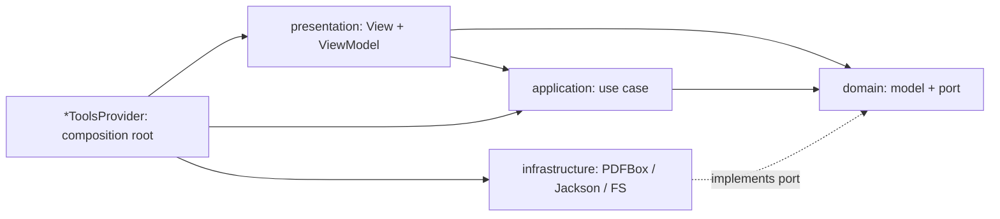

# Toolbox

Aplikasi desktop (JavaFX) yang menggabungkan utility harian (PDF, JSON/CSV, developer tools, dan productivity) dalam satu jendela. Berjalan **100% offline** di **Windows 11** dan **Ubuntu 22.04/24.04**.

## Kenapa Ada

| Masalah | Jawaban Toolbox |
|---|---|
| Utility tersebar di banyak situs, aplikasi, dan CLI | Satu aplikasi: pilih tool dari Home, pindah lewat sidebar |
| Situs online minta dokumen (kontrak, log, data internal) di-upload ke server | Tanpa server, tanpa telemetry, tanpa network call |
| Viewer/editor umum freeze pada file ratusan MB | Proses streaming di background. Target: JSON ~200 MB (400 ribu record) dengan RAM < 400 MB |
| Tool favorit beda antara Windows dan Ubuntu | Satu codebase, perilaku sama di kedua OS |

Tool yang tersedia:

| Kategori | Tool |
|---|---|
| PDF | Isi & TTD, Gabung, Pisah, Kompres |
| Data | JSON Viewer, JSON Beautify, CSV Kolom: Split & Merge |
| Dev Utils | JWT Debugger, Encoder/Decoder, Hash Generator, Checksum, Text Diff, Regex Tester, SQL Formatter, Cron Builder, QR Code, Git Command Builder, Mock Data Generator |
| Extra Tools | Text Tools, Batch Rename, Installment Simulator, Budget |

Detail kebutuhan dan aturan tiap tool: [docs/business.md](docs/business.md).

## Prerequisite

| Software | Versi | Catatan |
|---|---|---|
| [BellSoft Liberica JDK](https://bell-sw.com/pages/downloads/) **Full** | 21 | Varian **Full** sudah membawa JavaFX. JDK tanpa JavaFX gagal compile |
| Maven | ≥ 3.9 | Tidak perlu install. Pakai wrapper `./mvnw` (Maven 3.9.11) |
| Git | terbaru | |

Versi minimum Java dan Maven dicek oleh `maven-enforcer-plugin` saat build.

Install Liberica 21 Full via [SDKMAN](https://sdkman.io/) (Linux):

```bash
sdk list java | grep librca      # cari 21.x.x.fx-librca
sdk install java 21.x.x.fx-librca
java -version                    # harus "Liberica", versi 21
java --list-modules | grep javafx  # harus ada javafx.controls & javafx.swing
```

Windows: pakai installer `.msi` varian **Full JDK**, lalu pastikan `JAVA_HOME` mengarah ke JDK tersebut.

### Compile & Run

```bash
./mvnw verify                  # compile + test + ArchitectureTest + spotless:check
./mvnw spotless:apply          # rapikan format (palantir-java-format)
./mvnw package -DskipTests     # hasil: app/target/toolbox-app.jar + app/target/libs/

java -Xmx320m -jar app/target/toolbox-app.jar              # buka Home
java -Xmx320m -jar app/target/toolbox-app.jar file.pdf     # simulasi "Open with"
```

Windows: ganti `./mvnw` dengan `.\mvnw.cmd`.

- `toolbox-app.jar` memakai `Class-Path: libs/`, jadi folder `libs/` harus tetap di sebelah jar.
- IntelliJ IDEA: buka `pom.xml` root, set Project SDK ke Liberica 21 Full, run `io.github.lukmnh.toolbox.app.Main`.
- Test satu module: `./mvnw -pl tool-pdf -am test`.
- Data dummy JSON besar untuk uji performa: `java tools/GenerateSample.java 400000 sample.json`.

| Gejala | Penyebab | Solusi |
|---|---|---|
| `package javafx.scene does not exist` | JDK bukan Liberica **Full** | Install Liberica 21 Full, set `JAVA_HOME` |
| Enforcer `RequireJavaVersion failed` | Java < 21 | Ganti ke JDK 21 |
| `The following files had format violations` | Format tidak sesuai | `./mvnw spotless:apply` |
| `ArchitectureTest` gagal | Import melanggar dependency rule | Pindahkan kode ke layer yang benar, baca pesan ArchUnit |
| `NoClassDefFoundError` saat `java -jar` | `libs/` hilang atau jar dipindah sendirian | `./mvnw package -DskipTests` ulang |

## Data Lokal

Tanpa database. Semua state tersimpan di `~/.toolbox/` (dibuat owner-only saat aplikasi start):

| Path | Isi |
|---|---|
| `settings.properties` | Tema (light/dark) |
| `guide.md` | Guide di Home hasil edit user. Tidak ada = pakai guide bawaan |
| `recent.json` | File JSON terakhir dibuka |
| `signature.png` | Tanda tangan terakhir (tool Isi & TTD) |
| `budgets/` | Data Budget, 1 file JSON per budget, autosave atomic |
| `rename-history/` | Log undo Batch Rename |
| `tmp/` | Temp file aplikasi (bukan `java.io.tmpdir`), dibersihkan saat tool ditutup/aplikasi keluar |

Hapus folder `~/.toolbox/` untuk reset total. Uninstall aplikasi tidak menghapus folder ini.

## Struktur Module

```text
toolbox/
├── pom.xml              # parent: versi library/plugin, enforcer, spotless
├── common/              # kontrak Tool, task runner, download, settings, i18n, security helper, UI reusable, tema CSS
├── tool-pdf/            # Isi & TTD, Gabung, Pisah, Kompres (PDFBox)
├── tool-json/           # JSON Viewer, JSON Beautify, CSV Split & Merge (Jackson streaming, FastCSV)
├── tool-devutils/       # JWT, Encoder, Hash, Checksum, Diff, Regex, SQL, Cron, QR
├── tool-productivity/   # Text Tools, Batch Rename, Installment Simulator, Budget (FastExcel)
├── app/                 # shell: Home, sidebar, guide, routing "Open with", main class
├── tools/               # GenerateSample.java (generator JSON dummy)
├── packaging/           # aset jpackage (icons/)
└── docs/                # kebutuhan bisnis, flowchart
```

Arah dependency antar module: `app` → `tool-*` → `common`. Module `tool-*` tidak saling bergantung.

| Area | Teknologi |
|---|---|
| Bahasa | Java 21 (`record`, `sealed`, pattern matching, virtual threads) |
| UI | JavaFX dari Liberica Full, tanpa FXML, styling via CSS |
| Library utama | PDFBox 3, Jackson, FastCSV, FastExcel, java-diff-utils, RE2/J, sql-formatter, cron-utils, ZXing, commonmark |
| Build | Maven multi-module + Wrapper, Enforcer, Spotless |
| Test | JUnit 5, ArchUnit |

## Arsitektur

Per tool: **Clean Architecture pragmatis** + MVVM di UI, feature-first (satu folder per tool).

```text
tool-pdf/src/main/java/io/github/lukmnh/toolbox/pdf/
├── merge/
│   ├── domain/           # record + port (interface), JDK saja
│   ├── application/      # use case, 1 class = 1 aksi
│   ├── infrastructure/   # adapter PDFBox / filesystem, implement port
│   └── presentation/     # View + ViewModel
├── split/  compress/  sign/
├── shared/               # dipakai >1 tool di module ini
└── PdfToolsProvider.java # composition root, didaftarkan via ServiceLoader
```

| Layer | Boleh bergantung ke |
|---|---|
| `domain` | JDK saja |
| `application` | `domain`, `common.task` |
| `infrastructure` | `domain`, library eksternal |
| `presentation` | `application`, model `domain`, `common.ui` |

- Rule di atas ditegakkan `ArchitectureTest` (ArchUnit) di tiap module. Folder tool dalam satu module tidak saling import.
- Tanpa DI framework. Tiap module punya satu `*ToolsProvider` yang merakit dependency manual.
- Shell `app` menemukan tool lewat `ServiceLoader<ToolProvider>`. Tool baru muncul di Home tanpa mengubah `app`.
- Pindah tool: `canClose()` → `dispose()` → `createView()` tool baru (lazy), supaya memori lepas.
- Kerja berat jalan di virtual thread lewat `TaskRunner`, dengan progress dan cancel.



## Workflow Kontribusi

1. Branch dari `development`: `feat/<topik>` atau `fix/<topik>`.
2. Commit pakai [Conventional Commits](https://www.conventionalcommits.org/), scope per module: `common`, `app`, `pdf`, `json`, `devutils`, `productivity`, `build`, `ci`.

   ```text
   feat(pdf): tambah preset kompres ukuran kecil
   fix(json): perbaiki offset indexer untuk file dengan BOM
   ```

3. Sebelum push: `./mvnw spotless:apply verify` harus hijau.
4. Pull Request ke `development`, squash merge.

Menambah tool baru di module yang sudah ada:

1. Buat folder `<tool>/` dengan `domain/`, `application/`, `presentation/` (+ `infrastructure/` kalau ada I/O atau library eksternal).
2. Implement `Tool` (`id`, `name`, `description`, `category`, `createView`, `dispose`; override `canClose` kalau ada state belum tersimpan).
3. Daftarkan di `*ToolsProvider.tools()` module tersebut.
4. Teks UI masuk `common/src/main/resources/i18n/messages.properties`, tanpa string hard-coded.
5. Tulis test untuk `domain`, `application`, `infrastructure`. `ArchitectureTest` otomatis mengecek folder baru.

Module/kategori baru: tambah ke `<modules>` parent `pom.xml`, tambah dependency di `app/pom.xml`, daftarkan provider di `META-INF/services/io.github.lukmnh.toolbox.common.tool.ToolProvider`, tambah nilai di `ToolCategory`.

Versi mengikuti [SemVer](https://semver.org/): `./mvnw versions:set -DnewVersion=X.Y.Z`.

## Dokumentasi

| Dokumen | Isi |
|---|---|
| [docs/business.md](docs/business.md) | Tujuan, ruang lingkup, kebutuhan fungsional, aturan bisnis, NFR, kriteria rilis, risiko |
| [docs/flowcharts.md](docs/flowcharts.md) | Diagram alur aplikasi dan tiap tool (Mermaid) |

## Trade-off

| Keputusan | Keuntungan | Harga yang dibayar |
|---|---|---|
| JavaFX dari **Liberica Full JDK**, bukan dependency OpenJFX di Maven | `pom.xml` sederhana, tanpa artifact JavaFX per OS/arsitektur | Developer wajib pakai JDK spesifik. JDK biasa gagal compile |
| Desktop **100% offline** | Privasi total, tidak ada server untuk dirawat | Tanpa sync, auto-update, atau crash report. Update manual |
| **File di `~/.toolbox/`**, tanpa database | Nol setup, mudah di-backup/di-reset, tulis atomic | Tidak ada query/relasi. Cocok hanya untuk data kecil per user |
| **Clean Architecture per tool** + ArchUnit | Tool terisolasi, use case bisa dites dengan fake tanpa PDFBox/JavaFX, rule tidak bisa dilanggar diam-diam | Boilerplate lebih banyak (record, port, use case, provider) untuk tool sederhana |
| **Manual wiring + ServiceLoader**, tanpa DI framework | Startup cepat, tanpa reflection/magic, dependency terlihat di satu file | `*ToolsProvider` membesar seiring jumlah tool |
| **Maven multi-module** per kategori | Batas dependency jelas, build/test per module (`-pl … -am`) | Menambah kategori = sentuh parent POM, `app/pom.xml`, dan `ToolCategory` |
| **Thin jar + `libs/`**, bukan fat jar | Build cepat, tidak ada konflik `META-INF` antar library | Jar tidak bisa dipindah sendirian |
| **Classpath**, bukan JPMS (`module-info`) | Kompatibel dengan semua library tanpa konfigurasi modul | Enkapsulasi antar module hanya dijaga ArchUnit, bukan compiler |
| **Streaming + lazy view + virtual threads** | File ratusan MB tetap jalan dengan heap kecil, UI tidak freeze | Kode lebih kompleks (index, cancel, progress) dibanding load-all |
| Regex JavaScript/PHP lewat **terjemahan ke `java.util.regex`**, Go lewat RE2/J | Tanpa engine native/eksternal, tetap offline | Perilaku edge case bisa beda dari engine asli |
