# Flowcharts

Diagram alur utama Toolbox dalam format [Mermaid](https://mermaid.js.org/). GitHub dan IntelliJ IDEA (plugin Mermaid) merender diagram ini secara langsung.

> Diagram ini mengikuti spesifikasi. Kalau implementasi berubah, perbarui diagram di PR yang sama.

## Daftar Isi

- [A. Navigasi App](#a-navigasi-app)
- [B. Ganti Tool](#b-ganti-tool)
- [C. Download Hasil](#c-download-hasil)
- [D. Background Task](#d-background-task)
- [E. JSON Viewer (File Besar)](#e-json-viewer-file-besar)
- [F. JSON Beautify](#f-json-beautify)
- [G. Kompres PDF](#g-kompres-pdf)
- [H. Regex Tester (Timeout)](#h-regex-tester-timeout)
- [I. Checksum Verify](#i-checksum-verify)
- [J. Dependency Rule (Clean Architecture)](#j-dependency-rule-clean-architecture)
- [K. Development → Rilis → Install](#k-development--rilis--install)

---

## A. Navigasi App

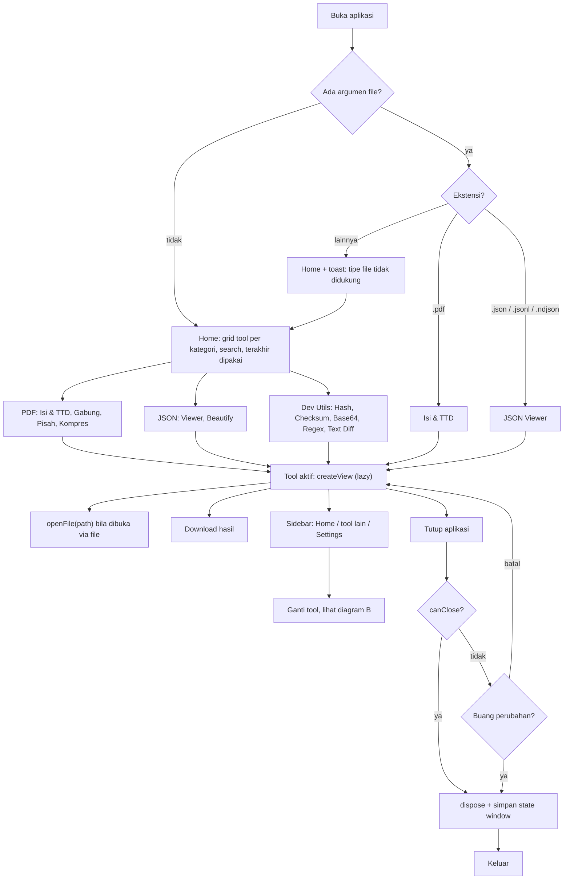

## B. Ganti Tool

Hanya **satu tool aktif** dalam satu waktu. Tool lama dilepas sepenuhnya sebelum tool baru dibuat supaya memori turun lagi.

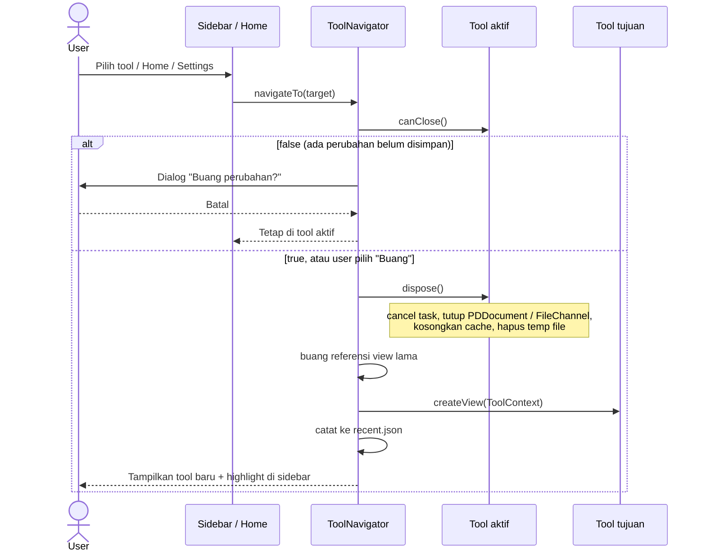

## C. Download Hasil

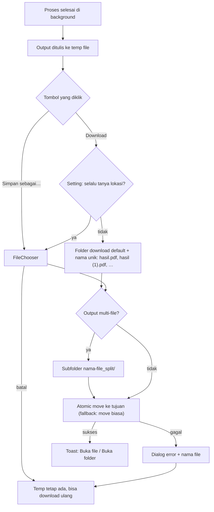

Resolusi folder download default:

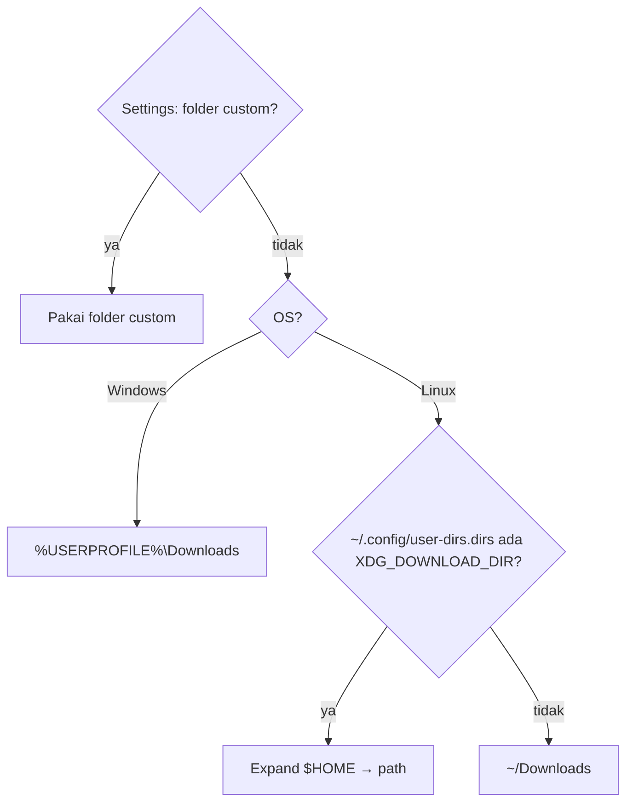

## D. Background Task

Semua proses berat (PDF, indexing JSON, checksum, diff, regex) berjalan lewat `TaskRunner`. UI hanya diperbarui di FX thread.

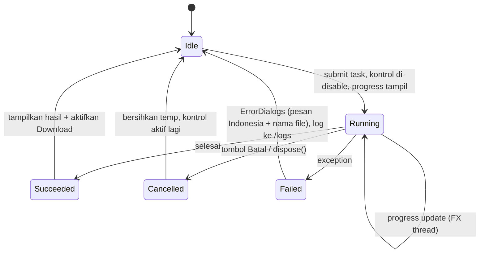

## E. JSON Viewer (File Besar)

Target: 400 ribu record (~200 MB) dengan total RAM aplikasi < 400 MB. File tidak pernah dimuat utuh ke memori.

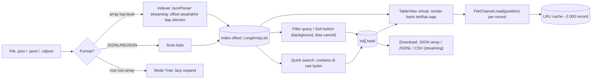

## F. JSON Beautify

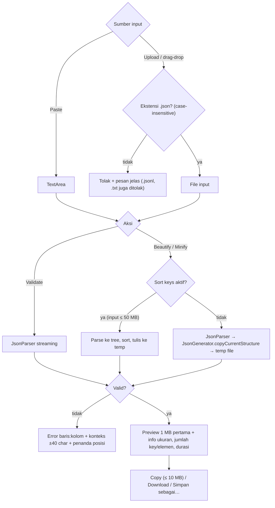

## G. Kompres PDF

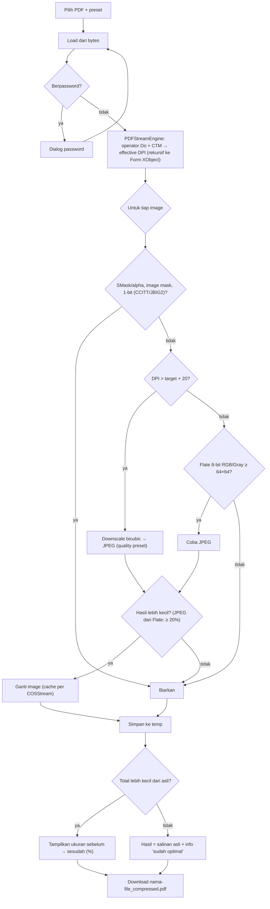

Preset:

| Preset | DPI target | Kualitas JPEG |
|---|---|---|
| Seimbang (default) | 150 | 0.75 |
| Kualitas tinggi | 200 | 0.85 |
| Ukuran kecil | 110 | 0.60 |

## H. Regex Tester (Timeout)

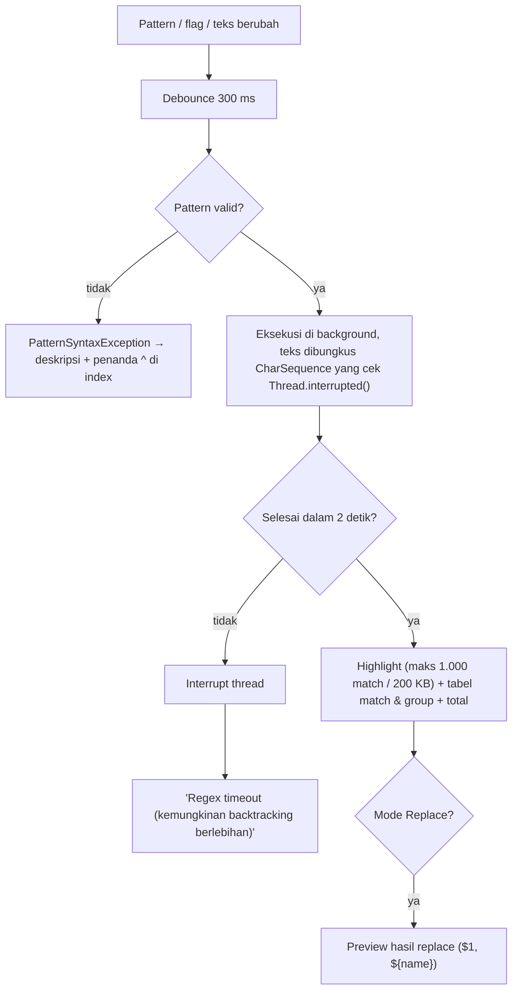

## I. Checksum Verify

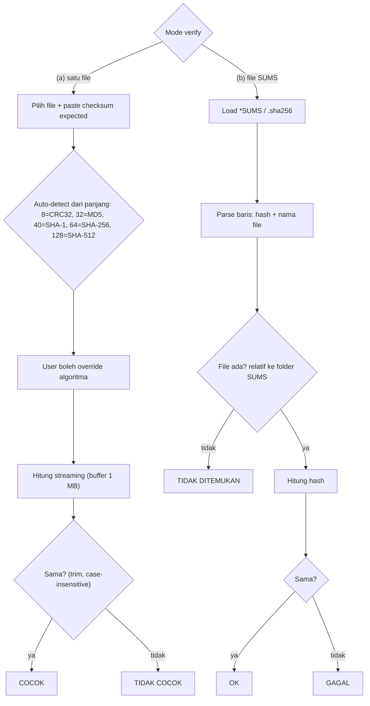

## J. Dependency Rule (Clean Architecture)

Ditegakkan oleh `ArchitectureTest` (ArchUnit) di setiap module.

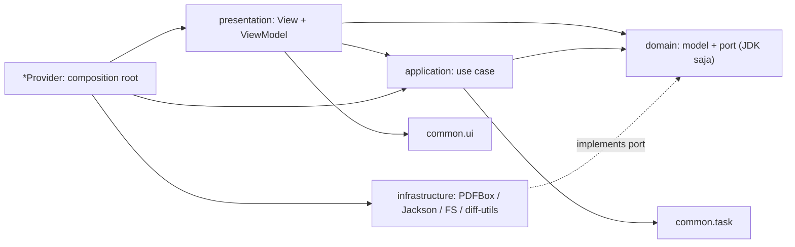

Dependency antar module (satu arah):

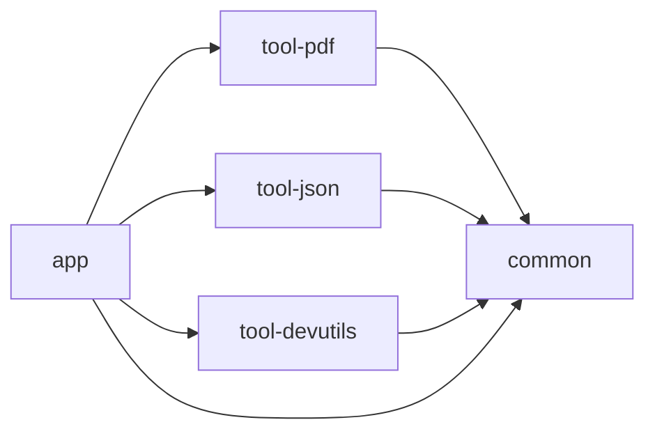

Antar module `tool-*` tidak boleh saling depend. Antar folder tool di dalam satu module (misalnya `merge/` dan `split/`) tidak boleh saling import. Kode yang dipakai bersama masuk ke `shared/`.

## K. Development → Rilis → Install

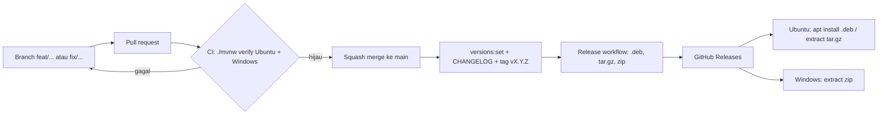
